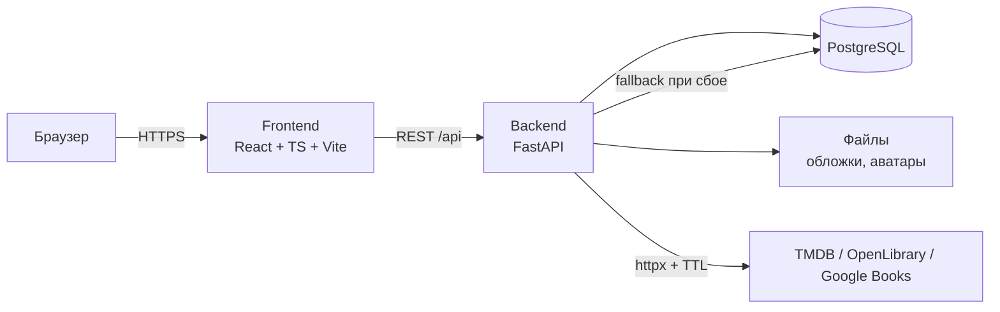

# Архитектура

Документ фиксирует, **как** мы реализуем требования ТЗ: из чего состоит приложение, где какая логика живёт и о чём договорились заранее, чтобы не мешать друг другу в коде. Меняется только через ADR (`docs/decisions/`).

## 1. Общая схема



Три сервиса в `docker-compose.yml`: `api`, `db`, `frontend`. Порт БД наружу не публикуется (ТЗ п. 5.2).

## 2. Слои бэкенда

```
api/routes/*   HTTP: валидация входа, коды ответов, права через зависимости
schemas/*      Pydantic-схемы запросов и ответов (контракт из docs/api.md)
services/*     бизнес-логика: правила, транзакции, интеграции, кэш
models/*       SQLAlchemy-модели и связи
db/*           движок, сессия, Base
core/*         настройки, безопасность, общие исключения
```

Правило: **маршрут не содержит бизнес-правил**. Если в обработчике появился `if` про статус, рейтинг или права — это сервис.

Асинхронность сквозная: `async def` маршруты, `AsyncSession`, `httpx.AsyncClient`. Никаких блокирующих вызовов в обработчике.

## 3. Слои фронтенда

```
app/          роутер, провайдеры (QueryClient, AuthProvider), оболочка
pages/        страницы верхнего уровня, собирают фичи
features/*    фича = api-хуки + компоненты + типы; одна подсистема = одна папка
components/   ui-кит (Button, Input, Modal, Rating...) и layout (Header, Sidebar)
lib/          axios/fetch-обёртка, обработка 401, форматтеры
```

Правило: страница не ходит в сеть напрямую — только через хуки своей фичи. Общие типы API лежат в `lib/types.ts` и повторяют `docs/api.md`.

## 4. Аутентификация и сессии

- Пароль — `bcrypt` (или `argon2`), в БД только хэш.
- Вход по логину **или** e-mail: поле `login` + `email`, оба уникальны.
- После входа выдаём JWT (`HS256`, `SECRET_KEY`), внутри `sub` (id), `jti`, `role`, `exp`.
- `jti` пишется в таблицу `sessions`. Каждый запрос проверяет: токен валиден **и** сессия не отозвана.
- Токен хранится на клиенте и отправляется в `Authorization: Bearer <token>`.
- **Смена пароля** отзывает все сессии пользователя (ТЗ 4.2.4). **Блокировка** пользователя тоже (ТЗ 4.6.4).
- Заблокированный пользователь получает 403 `Аккаунт заблокирован` на любой запрос с валидным токеном.
- Гость = запрос без токена. Права проверяются зависимостями: `get_current_user` (401), `require_moderator` / `require_admin` (403).

## 5. Роли

| Роль | Что может |
| --- | --- |
| `guest` | Чтение каталога, карточек, публичных рецензий и списков |
| `user` | Всё выше + свои полки, оценки, рецензии, комментарии, лайки, подписки, локальные карточки, жалобы |
| `moderator` | Всё выше + очередь жалоб, скрытие/удаление материалов, подтверждение локальных карточек |
| `admin` | Всё выше + роли, блокировки, удаление пользователей, сводка и журнал |

Роль хранится в `users.role`. Иерархия проверяется числовым уровнем, чтобы не расписывать матрицу в каждом маршруте.

## 6. Каталог и внешние источники

Единая карточка `catalog_items` для трёх типов: `book`, `movie`, `series`.

- `source`: `local` | `tmdb` | `openlibrary` | `google_books`.
- `external_id`: id в источнике (для локальных — `null`).
- `is_local`: признак кыргызского/локального контента; вместе с `country` даёт региональный фильтр «Кыргызстан» (ТЗ 4.3.1).
- `moderation_status`: `pending` (на проверке) | `approved` | `hidden`.

**Поиск:**

1. Ищем в локальной БД (включая кэш ранее загруженных карточек).
2. Параллельно (`asyncio.gather`) спрашиваем доступные внешние источники; ошибки источников не роняют запрос — логируем и продолжаем (ТЗ 2.3, 4.3.2).
3. Нормализуем и дедуплицируем по `(source, external_id)`, а для локальных — по названию и году.
4. Сохраняем найденное в БД с `fetched_at`, отдаём объединённый список.

**Кэш:** `fetched_at` + `CACHE_TTL_DAYS` (по умолчанию 7 дней). Устаревшая карточка отдаётся сразу, а обновление запускается при обращении, если источник доступен.

**Локальные карточки:** создаёт пользователь, `moderation_status = pending`, видна автору и модераторам; после подтверждения — всем. Перед созданием — проверка совпадений по названию и году и подсказка «возможно, это она».

## 7. Полки, оценки, списки

- `user_items` — связь пользователь ↔ карточка: `status`, `rating`, `finished_at`, `added_at`. Одна запись на пару (пользователь, карточка).
- Статусы: `watching` («Читаю/Смотрю»), `finished` («Просмотрено/Прочитано»), `planned` («Запланировано»), `dropped` («Брошено»).
- `finished_at` заполняется при переходе в `finished`, редактируется пользователем.
- Оценка 1–10 (полшага не поддерживаем). Для `planned` оценка не запрашивается.
- Средний рейтинг карточки — денормализованные `rating_avg`, `ratings_count`, пересчёт в той же транзакции, что и изменение оценки.
- `lists` + `list_items`: `position`, `note` (≤ 500 символов), `theme` списка (`classic` | `noir` | `pastel` — минимум три, ТЗ 4.4.3). Публичный список доступен по `/lists/<id>` без авторизации.

## 8. Социальный контур

- `reviews` (одна рецензия пользователя на карточку), `comments` (к рецензии), `likes` (полиморфно: `target_type` + `target_id`), `follows`, `activity_events`.
- `activity_events` — материализованная лента: пишем событие (`review`, `finished`, `rating`, `public_list`) при действии, читаем по подпискам с `ORDER BY created_at DESC`.
- Скрытие/удаление материала помечает связанные события скрытыми, при удалении — удаляет (ТЗ 4.6.3).

## 9. Файлы

- Обложки карточек и аватары: сохраняем в `MEDIA_ROOT`, в БД — относительный путь.
- Разрешённые типы: `jpg`, `png`, `webp`; лимит `MAX_UPLOAD_SIZE_MB`.
- Имя файла генерируем (uuid), оригинальное не используем — безопасность и коллизии.
- При замене/удалении аватара старый файл удаляется с диска (ТЗ 4.2.4).

## 10. Ошибки и коды ответов

| Ситуация | Код | Тело |
| --- | --- | --- |
| Невалидные данные | 422 | стандартный FastAPI `detail` |
| Нет/просрочен токен | 401 | `{"detail": "Не авторизован"}` |
| Нет прав | 403 | `{"detail": "Недостаточно прав"}` |
| Объект не найден / скрыт | 404 | `{"detail": "Не найдено"}` |
| Конфликт (логин занят, дубль оценки) | 409 | `{"detail": "..."}` |
| Ошибка внешнего источника | 200 + частичный результат | источник пропущен, в лог — warning |
| Внутренняя ошибка | 500 | без стека в ответе |

## 11. Соглашения по коду

- Python: `ruff` + `black`-совместимый стиль (line length 100), типизация обязательна для публичных функций.
- TypeScript: strict, без `any` в новом коде, компоненты — function components.
- Комментарии по-русски, имена сущностей — по-английски.
- Всё, что описано в ТЗ цифрой (500 символов, 3 темы, причины жалоб), живёт в константах `app/core/constants.py` и `frontend/src/lib/constants.ts`.

## 12. Что осознанно не делаем

См. ТЗ п. 2.4: воспроизведение контента, продажи, мобильные приложения, push, ML-рекомендации. Не добавляем «пока не просили» — сначала закрываем ТЗ.
