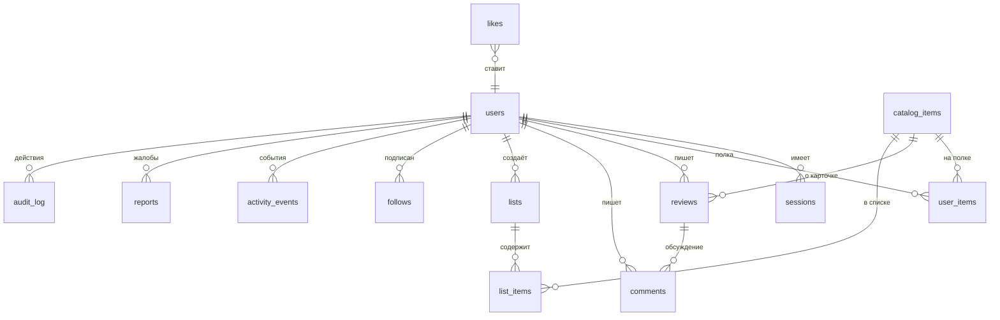

# Модель данных

Схема БД и правила, которые нельзя нарушать при разработке. Источник истины — модели в `backend/app/models/`, изменения — только через миграции Alembic.

## Схема связей

## Таблицы

### `users`

| Поле | Тип | Примечание |
| --- | --- | --- |
| `id` | serial PK | |
| `login` | varchar(32) unique | 3–32, `[a-zA-Z0-9_]`, основа публичного URL |
| `email` | varchar(255) unique | |
| `password_hash` | varchar(255) | bcrypt/argon2, никогда не отдаём наружу |
| `role` | enum | `user` (default), `moderator`, `admin` |
| `bio` | varchar(500) null | краткое описание |
| `avatar_path` | varchar(255) null | относительный путь в `MEDIA_ROOT` |
| `is_blocked` | bool default false | блокировка админом |
| `created_at` / `updated_at` | timestamptz | |

### `sessions`

| Поле | Тип | Примечание |
| --- | --- | --- |
| `id` | serial PK | |
| `user_id` | FK → users, `ON DELETE CASCADE` | |
| `jti` | uuid unique | id токена |
| `expires_at` | timestamptz | |
| `revoked_at` | timestamptz null | logout, смена пароля, блокировка |
| `created_at` | timestamptz | |

### `catalog_items`

| Поле | Тип | Примечание |
| --- | --- | --- |
| `id` | serial PK | |
| `type` | enum | `book`, `movie`, `series` |
| `source` | enum | `local`, `tmdb`, `openlibrary`, `google_books` |
| `external_id` | varchar(64) null | id в источнике; `unique(source, external_id)` |
| `title` | varchar(500) | |
| `original_title` | varchar(500) null | |
| `title_normalized` | varchar(1000) | `lower(title + original_title)`, заполняется приложением |
| `year` | int null | |
| `country` | varchar(100) null | |
| `genres` | varchar[] / jsonb | список жанров |
| `description` | text null | |
| `poster_path` | varchar(255) null | локальный файл или внешний URL |
| `is_local` | bool default false | признак локального (кыргызского) контента |
| `moderation_status` | enum | `approved` (default для внешних), `pending`, `hidden` |
| `created_by` | FK → users null | автор локальной карточки |
| `rating_avg` | numeric(4,2) default 0 | денормализация, 10.00 тоже влезает |
| `ratings_count` | int default 0 | денормализация |
| `fetched_at` | timestamptz null | когда данные получены из источника (TTL-кэш) |
| `created_at` / `updated_at` | timestamptz | |

Индексы: `(type)`, `(year)`, `(is_local)`, `(title_normalized)`, `(source, external_id)`.

### `user_items` (полка)

| Поле | Тип | Примечание |
| --- | --- | --- |
| `id` | serial PK | |
| `user_id` | FK → users cascade | `unique(user_id, item_id)` |
| `item_id` | FK → catalog_items cascade | |
| `status` | enum | `watching`, `finished`, `planned`, `dropped` |
| `rating` | int null | 1–10 |
| `finished_at` | date null | обязательна для `finished` |
| `added_at` | timestamptz | сортировка «по дате добавления» |

### `reviews`

| Поле | Тип | Примечание |
| --- | --- | --- |
| `id` | serial PK | |
| `user_id` | FK → users cascade | `unique(user_id, item_id)` |
| `item_id` | FK → catalog_items cascade | |
| `title` | varchar(200) | |
| `body` | text | |
| `rating` | int null | 1–10, копия оценки на момент рецензии |
| `is_hidden` | bool default false | решение модератора |
| `created_at` / `updated_at` | timestamptz | |

### `comments`

| Поле | Тип | Примечание |
| --- | --- | --- |
| `id` | serial PK | |
| `review_id` | FK → reviews cascade | |
| `user_id` | FK → users cascade | |
| `body` | varchar(1000) | |
| `is_hidden` | bool default false | |
| `created_at` | timestamptz | |

### `likes`

| Поле | Тип | Примечание |
| --- | --- | --- |
| `id` | serial PK | |
| `user_id` | FK → users cascade | `unique(user_id, target_type, target_id)` |
| `target_type` | enum | `review`, `comment` |
| `target_id` | int | полиморфная ссылка |
| `created_at` | timestamptz | |

### `lists` / `list_items`

| `lists` | Тип | Примечание |
| --- | --- | --- |
| `id` | serial PK | постоянная публичная ссылка `/lists/{id}` |
| `user_id` | FK → users cascade | |
| `title` | varchar(200) | |
| `description` | varchar(1000) null | |
| `is_public` | bool default false | |
| `theme` | enum | `classic`, `noir`, `pastel` |
| `created_at` / `updated_at` | timestamptz | |

| `list_items` | Тип | Примечание |
| --- | --- | --- |
| `id` | serial PK | |
| `list_id` | FK → lists cascade | `unique(list_id, item_id)` |
| `item_id` | FK → catalog_items cascade | |
| `position` | int | порядок, переиндексация при перемещении |
| `note` | varchar(500) null | личная заметка |
| `added_at` | timestamptz | |

### `follows`

| Поле | Тип | Примечание |
| --- | --- | --- |
| `follower_id` | FK → users cascade | PK часть |
| `following_id` | FK → users cascade | PK часть, `follower_id != following_id` |
| `created_at` | timestamptz | |

### `activity_events` (лента)

| Поле | Тип | Примечание |
| --- | --- | --- |
| `id` | serial PK | |
| `user_id` | FK → users cascade | автор события |
| `type` | enum | `review_created`, `item_finished`, `rating_set`, `list_published` |
| `target_type` | enum | `review`, `item`, `list` |
| `target_id` | int | |
| `payload` | jsonb | подписи для ленты (название, оценка) |
| `is_hidden` | bool default false | скрывается вместе с материалом |
| `created_at` | timestamptz | индекс `(created_at DESC)` |

### `reports`

| Поле | Тип | Примечание |
| --- | --- | --- |
| `id` | serial PK | |
| `reporter_id` | FK → users cascade | |
| `target_type` | enum | `review`, `comment`, `card`, `profile` |
| `target_id` | int | |
| `reason` | enum | `spam`, `insult`, `false_info`, `copyright`, `other` |
| `comment` | varchar(1000) null | |
| `status` | enum | `open`, `rejected`, `resolved` |
| `resolved_by` | FK → users null | |
| `resolution` | enum null | `hide`, `delete` |
| `resolution_note` | varchar(1000) null | причина решения |
| `created_at` / `resolved_at` | timestamptz | |

### `audit_log`

| Поле | Тип | Примечание |
| --- | --- | --- |
| `id` | serial PK | |
| `actor_id` | FK → users null | `SET NULL`, чтобы журнал пережил удаление аккаунта |
| `action` | varchar(64) | `report.resolve`, `card.approve`, `user.role_change`, `user.block`, `user.delete`… |
| `target_type` / `target_id` | varchar / int | что изменено |
| `details` | jsonb null | было/стало |
| `created_at` | timestamptz | |

## Правила

1. **Каскады.** Удаление пользователя уносит сессии, полки, оценки, рецензии, комментарии, лайки, подписки, списки, файлы, события и жалобы (ТЗ 4.6.4). В `audit_log` остаётся история с `actor_id = NULL`.
2. **Скрытие ≠ удаление.** `is_hidden` убирает материал из выдачи, но сохраняет данные для разбора. Удаление — физическое и каскадное.
3. **Денормализация рейтинга** обновляется в одной транзакции с изменением оценки; расхождений быть не должно (проверяем тестом).
4. **Кэш внешних источников** живёт в `catalog_items` (`fetched_at`), отдельной таблицы кэша не заводим.
5. **Миграции** — только через Alembic, с осмысленным именем (`0002_catalog_items.py`). Правка уже применённой миграции запрещена.
6. **SQLite для тестов**: не использовать `ARRAY`/`JSONB`-специфику напрямую — через `JSON`-тип SQLAlchemy, чтобы тесты не падали.
